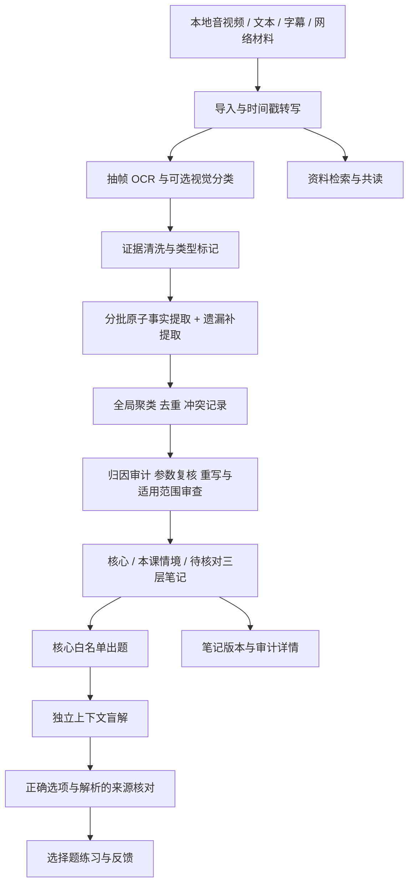

# 研习伴：现有架构、验证结果与不足

记录日期：2026-10-22（Asia/Shanghai）。这是当前源码快照说明，不是产品发布或质量认证。

## 1. 当前定位与结论

研习伴目前是可运行的本地单用户学习工具研发原型（应用版本0.2.0、笔记管线2.1.0）。目标保持学科和学段通用：帮助个人理解课程，也计划用于少量家庭本地安装私测。目前尚未达到可向学生家庭承诺稳定质量的产品级状态。

个人湿实验学习已能完成资料导入、转写、整理、共读和选择题练习，但不能把生成笔记或skill当作经核验的实验SOP，也不能把答题正确率当作实际操作能力。

当前优先级已经调整：暂停扩大产品化功能，优先解决笔记与视频之间的核实成本和信任问题。本快照只保存现状，不代表该交互重构已完成。

## 2. 实际架构

| 部分 | 代码位置 | 当前实现与边界 |
|---|---|---|
| 前端 | `public/index.html`、`app.js`、`style.css` | 原生浏览器界面；中央笔记、资料、练习、共读、媒体播放。尚未形成顺畅的逐句双向视频溯源工作台。 |
| 服务 | `server.mjs` | Node.js本地HTTP服务，生产入口绑定127.0.0.1；检查Host/Origin。单用户设计，不是带家庭租户隔离的云端服务。 |
| 持久化 | `data/store.json`、`data/media/` | JSON元数据及本地媒体；临时文件后rename保存。已有回收站、版本和备份恢复入口，不等于完整灾备或多进程数据库。 |
| 导入与转写 | `transcription.mjs`、`src/extractors/`、`scripts/` | 本地视频导入保留；网络摄取依赖外部工具/站点；转写有队列、取消、重试，重启后中断任务需恢复。 |
| 多模态证据 | `scripts/visual_review.py`、`src/evidence_cleaner/` | 区分ASR、字幕、课件、仪器/UI、视觉推断及未知画面；未知不直接当课件；视觉分类有预算，非整课视觉理解。 |
| 原子事实 | `src/note_synthesizer/` | 小批提取与遗漏检查，引用逐字校验，参数记录对象/阶段/含义/来源；全局分组异常保留卡片并记录修复。 |
| 审计 | `src/attribution_auditor/` | 识别提取错误、模型归纳错误、教学源偏差候选；参数复核、重写复审和独立反例检查。漏审保守待核对；仍可能误判。 |
| 笔记渲染 | `src/note_renderer/` | 三层展示；未证实审计理由留在详情，避免直接作为标准纠错；部分单次ASR记录保守提示回看。 |
| 出题 | `src/quiz_engine/` | 仅核心层准入，黑名单拦截，四选一，盲解后增加答案与解析来源核对；不为凑题数放行。 |
| 契约 | `src/schemas/`、`scripts/validate_pipeline.py` | Pydantic验证数据形状、引用相关门禁与题目验证记录；结构合法不代表语义正确。 |
| 共读与skill | `src/distiller/`、`src/skill_builder/`、`skills/` | 检索、问答和可移植学习材料生成；不是已验证的个人实验执行/复盘系统。 |
| 模型调用 | `src/pipeline/index.mjs`及服务适配 | 本地模型接口、阶段缓存、部分失败重试；不同审计上下文仍共用同一配置模型。 |
| 朗读 | `tts.mjs`、`tts_worker.py` | edge-tts需要联网，朗读文字发送到微软服务；不能称整个应用完全离线。 |

## 3. 已验证的事实与不能推出的结论

### 本次源码检查

2026-10-22执行：

- `npm run check`：通过。
- `npm test`：90/90通过。
- `.venv-ocr\Scripts\python.exe -m unittest discover -s tests -p 'test_*.py'`：19/19通过。

这些主要验证软件行为与契约，不验证所有教学内容是否正确；本次没有重跑整课模型生成、听完整视频或做新的浏览器交互验收。

### 已有真实课程验证

详细记录见[笔记质量修复回归](笔记质量修复回归.md)及`evaluation/2026-10-21/`。

| 指标 | 记录 |
|---|---|
| 同一30项清单完整覆盖 | 7 → 19 |
| 部分覆盖 | 4 → 11 |
| 清单中完全缺失 | 19 → 0 |
| 最终事实 | 88：7核心、66情境、15待核对 |
| 引用逐字匹配 | 118/118 |
| 最后记录的题组 | 2题通过，3题拒绝，未代用户作答 |

这是单门课程、开发过程中形成的探索性清单，由Codex复核，不是独立教师/专家金标准，也不是留出盲评。19/30不是准确率；118/118只说明引文在证据文本中存在，不证明推理成立。

曾有一道错误题通过盲解，原因是出题器与盲解器共同接受了无来源支持的机制解释。新增来源门禁后，该已知题真实重放被拒绝。这个案例证明需要多重检查，不证明所有类似错误都已解决。

## 4. 当前最大不足（按个人学习影响排序）

### 4.1 笔记与视频核实不顺畅——当前最高优先级

已有来源标记、时间戳和媒体能力，但尚未完成“点一句笔记→同屏播放相关片段→对照原话/画面→看清模型改写”的顺畅链路。多片段共同支持一句话时，依据组织和定位仍不充分；视频播放也不能可靠反向定位对应笔记。

不能宣称已有逐句可靠溯源、自动同步高亮或完整PPT/音频/笔记联合工作台。

### 4.2 语义错误与审计共同错误

已观察到：等待时间对象混接（B13）、百分点差与相对增幅混淆（B22）、省略步骤原因错接（B24）。还有部分事实被审计错误降级，如B07/B14；审计可能引入错误常识，而非纠正错误。

同一模型在不同上下文中的一致性不等于独立科学验证；当前没有完整外部权威来源核验或不同模型/人工专家交叉验证。

### 4.3 课程示例向个人任务迁移不足

三层笔记已有条件标签，但缺乏系统比较课程与个人任务在目标、对象、材料、设备、前提上的差异，不能稳定指出哪些内容可迁移、哪些必须重新核对。

### 4.4 学会识别答案不等于掌握技能

目前主要是选择题与反馈。缺乏成熟的延迟复测、换情境迁移、解释推理、结果预测、对照判断和能力评估。不能依据两道题或即时答对率声称掌握湿实验技能或提升了学习效果。

### 4.5 缺乏个人实验复盘闭环

尚未建立个人目标、预期、观察、异常、解释、下一次验证之间的结构化记录，也没有稳定将实际结果回写知识与复习计划。

### 4.6 信息优先级和认知负担

事实卡增多后正文较长，仍有英文参数字段、重复相关内容、过强措辞和待核对项。尚不能稳定给出“当前目标先学什么、暂时不背什么、哪里最需要核实”。

## 5. 面向家庭私测的额外缺口

- 尚无独立家庭/学生账号、角色权限、监护人管理与多设备隔离；本机访问限制不能替代这些能力。
- 缺少面向不同课程、年龄与学习水平的真实学习效果验证；通用目标不能替代分场景验收。
- 尚未完成儿童/家庭数据最小化、同意流程、外发告知、删除范围及第三方服务使用的完整设计与验证。
- 依赖本地模型、Python环境及外部工具；没有经多台普通家庭电脑验证的安装包、硬件基线、升级回滚与故障恢复体验。
- 缺少长任务延迟/成功率/资源消耗的稳定基线，不能承诺课程处理速度。
- `/api/state`是本地完整状态接口；无账号隔离，练习答案等仍在本地状态数据中，不是面向不可信多用户的权限边界。

## 6. 本次一并保存的开发中内容

上次用户要求暂停产品化时，已在工作树写入“题目有疑问”按钮与`report`动作：记录问题、隔离该题、阻止继续作答、从部分统计中排除。此次按“保存现有版本”要求随快照提交。

它只完成了代码雏形：**没有专门的举报/恢复/统计完整性验收，没有新的真实浏览器验证，也没有完整人工核对与重新发布流程**。上述90项现有测试通过不能作为这一功能专项验收完成的证据。T45仍未完成，产品化扩展仍按用户要求暂停。

另外保存工作树中已有的忽略规则变更、`cell-transfection.md`新增和旧协作skill文件删除。skill材料未做新的领域专家验收，不能当作已认证实验方案。

## 7. 后续建议顺序（尚未全部实现）

1. **溯源交互**：稳定句子/事实ID映射；点击定位片段、前后文、字幕与画面同屏；多来源逐条展示；视频反向定位；核对时间与成功率实测。
2. **语义质量**：按对象/步骤绑定参数；明确差值、相对量和单位；核查因果；支持审计意见被纠正；建立跨领域留出数据与人工复核标准。
3. **学习闭环**：围绕个人目标安排先修概念、短测、延迟复习和迁移判断；区分熟悉、理解、迁移与实操经验。
4. **个人任务复盘**：记录预期与观察、来源和不确定性，逐次追踪改进。
5. **家庭私测交付**：另行完成角色、数据处理、安装与恢复验收，再扩大使用范围。

以上是方向与待办，不是对完成日期或效果的承诺；本次任务不继续实现这些扩展。

## 8. GitHub快照范围与复现边界

上传的是源码、测试、文档、已纳入版本管理的评估记录和skill。`data/`、原视频、模型权重、虚拟环境、日志、cookie和本地备份不作为这次Git代码快照上传。

因此克隆仓库后需另装Node/Python与模型依赖。评估复算脚本依赖本机`data/pipeline-v2/`原始产物，单靠Git仓库中的评分JSON不能重建全部视频证据。GitHub备份代码不等于备份个人笔记、课程素材和完整运行环境。

本次不重启服务、不公开部署、不创建正式release；运行中的本地服务是否加载全部新改动需要单独验证。
